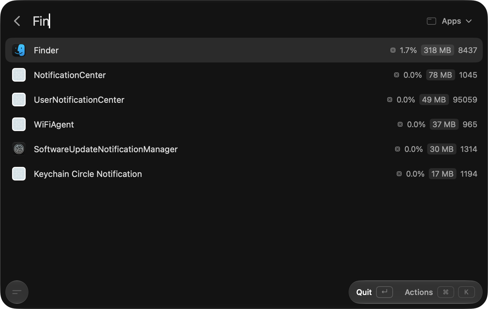
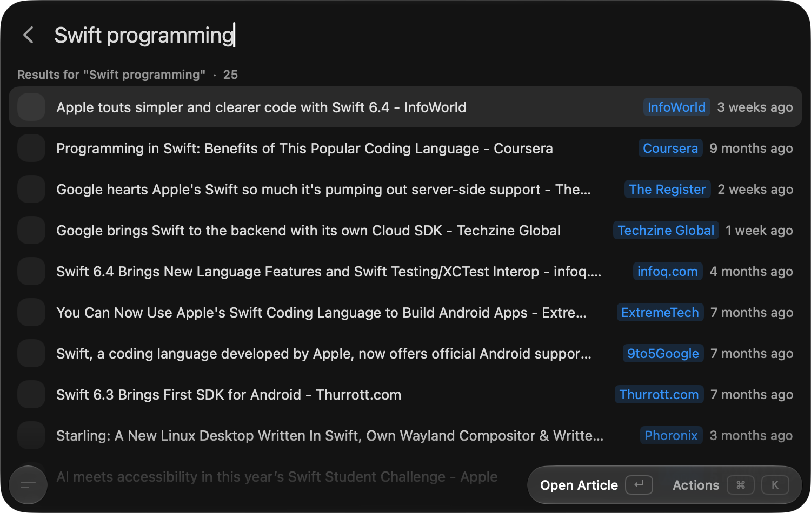
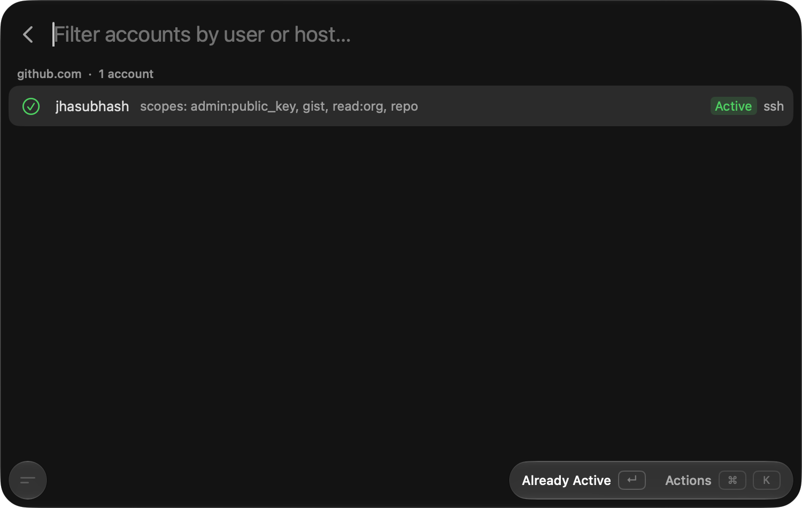
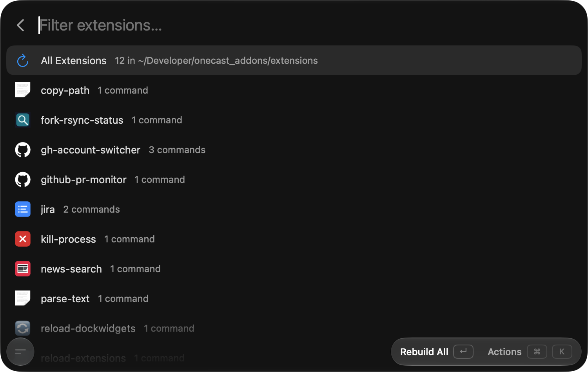
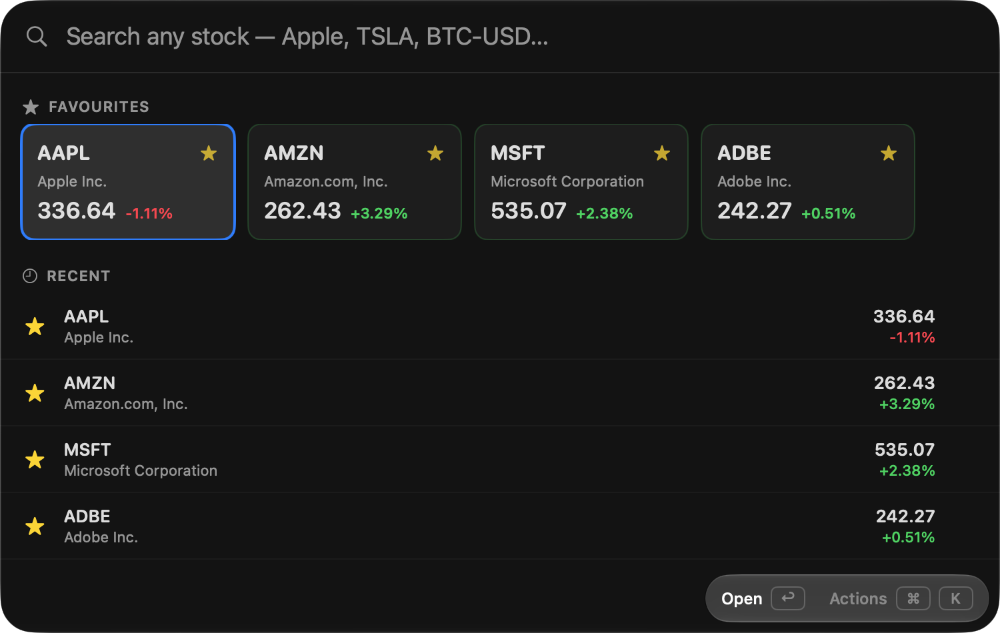
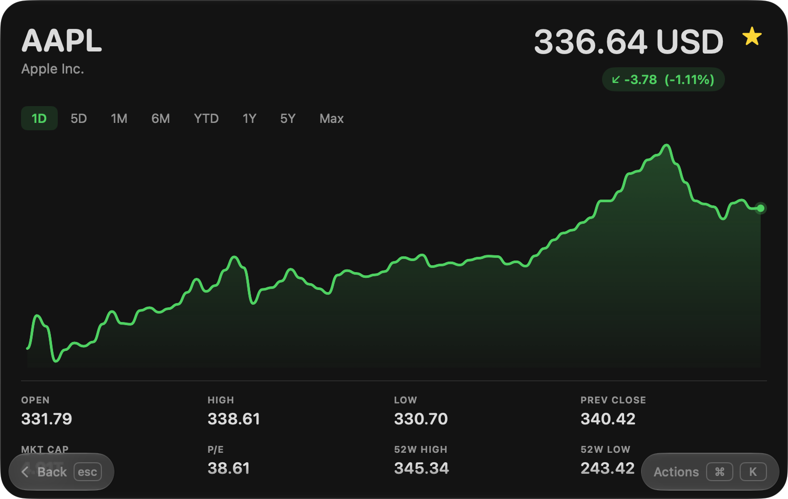
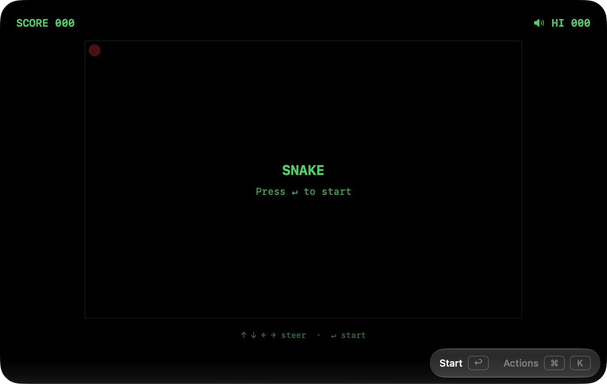
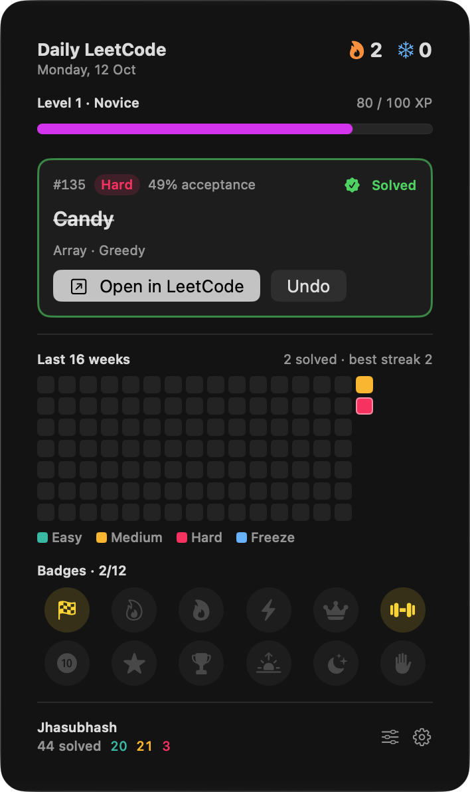
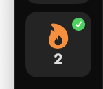

<div align="center">

# OneCast Addons

**Extensions, native Swift plugins and DockWidgets for [OneCast](https://github.com/jhasubhash/onecast).**

My own add-ons for the native macOS launcher. They live outside the app repo, so they never get in
the way of an upstream rebase and survive every release untouched.

[](https://github.com/jhasubhash/onecast/releases/latest)


<a href="https://www.buymeacoffee.com/subhashjha"></a>

</div>

| | Kind | What it is |
|---|---|---|
| 🧩 | **[Extensions](#-extensions)** | Raycast-compatible TypeScript extensions, run by OneCast's `@raycast/api` runtime. |
| 🦅 | **[Plugins](#-plugins)** | Native SwiftUI plugins OneCast compiles from source against `OnecastPluginKit`. |
| 🧱 | **[DockWidgets](#-dockwidgets)** | Live SwiftUI tiles for OneCast's custom docks, compiled the same way. |
| 🔗 | **[Quicklinks](#-quicklinks)** | Importable quicklink files. |

---

## 🧩 Extensions

<table>
<tr>
<td width="50%" valign="top">

<p><b>Kill Process</b>: everything running, apps, helpers and daemons, sorted by the memory or CPU it costs.
Quit or force-kill it, and see plainly when a process belongs to root.</p>
</td>
<td width="50%" valign="top">

<p><b>News Search</b>: top articles from Google News, with the source and age of each one.</p>
</td>
</tr>
<tr>
<td valign="top">

<p><b>GitHub Account Switcher</b>: switch the active <code>gh</code> account on github.com or GHES,
or toggle between two with no view at all.</p>
</td>
<td valign="top">

<p><b>Reload Extensions</b>: rebuild an extension from its source folder and install it into the
running app, one at a time or all of them.</p>
</td>
</tr>
</table>

And the rest:

| Extension | What it does |
|---|---|
| **Reload Plugins** | Rebuilds native Swift plugins from source and restarts OneCast so the new code loads. |
| **Reload DockWidgets** | Copies widgets from `dockwidgets/` into OneCast, which recompiles them and refreshes every live tile. |
| **Copy Path** | Copies what the frontmost app points at: Finder's selection as paths, a browser's page URL. |
| **Parse Text** | Cleans up the selected text (or the clipboard), starting with links a line-wrap split in two. |
| **Fork Sync Status** | Checks whether your fork is in sync with its upstream, using the `gh` CLI. |
| **GitHub PR Monitor** | Your open PRs and review requests, using the `gh` CLI. |
| **Jira** | Browse and search your issues with a Personal Access Token. |
| **Slack Status** | Set or clear your status with presets, emoji and an expiry, and swap your profile photo. |

## 🦅 Plugins

<table>
<tr>
<td width="50%" valign="top">

<p><b>Stock Quotes</b>: search any stock, fund or coin, star your favourites, and keep the recent
ones a keystroke away.</p>
</td>
<td width="50%" valign="top">

<p>Open one for its chart from one day to all time, with the open, high, low, market cap, P/E and
52-week range.</p>
</td>
</tr>
<tr>
<td valign="top">

<p><b>Snake</b>: retro snake, right in the palette.</p>
</td>
<td></td>
</tr>
</table>

`plugins/hello` is a small sample to start a new plugin from.

## 🧱 DockWidgets

<table>
<tr>
<td width="300" valign="top"></td>
<td valign="top">



**LeetCode**: a problem a day, with streaks, XP, freezes and badges. It picks a problem by your
difficulty and topics (or takes the daily challenge), marks the day done once your solution is
accepted, and reminds you through OneCast's scheduler until it is.

Click the tile for the detail view: today's problem, your level, sixteen weeks of history, badges
and your LeetCode totals.

</td>
</tr>
</table>

## 🔗 Quicklinks

`quicklinks/` holds **Search Google** and **Open in Finder**, ready to import from
**OneCast → Settings → Quicklinks**.

---

## Build & install

**Extensions** need a build step: restore the dependencies and bundle each command.

```sh
cd extensions/<name>
npm ci
npm run build          # esbuild writes <command>.js beside the manifest
```

Then add it in **OneCast → Settings → Extensions → Add** and pick the built folder. OneCast copies
the manifest, the built `<command>.js` files and `assets/` into
`~/Library/Application Support/<bundle id>/extensions/`. Each extension's `install.sh` does the same
from the command line.

**Plugins** have no build step: copy the manifest and sources into OneCast's plugins folder.

```sh
cd plugins/<name>
DEST="$HOME/Library/Application Support/com.onecast.app.dev/plugins/<name>"
mkdir -p "$DEST" && cp manifest.json *.swift "$DEST/"
```

OneCast compiles the sources against its own embedded framework, signs the dylib and caches it.
Turn on **Settings → Plugins**, then search for the plugin by name. Editing a source and reopening
the plugin rebuilds it with no relaunch. Building needs Xcode or the Command Line Tools.

**DockWidgets** work the same way, into the `dockwidgets` folder:

```sh
cd dockwidgets/<name>
DEST="$HOME/Library/Application Support/com.onecast.app.dev/dockwidgets/<name>"
mkdir -p "$DEST" && cp manifest.json *.swift "$DEST/"
```

Turn on **Settings → Docks**, allow third-party DockWidgets, and add the widget to a dock. To push
edits from this repo, run **Reload DockWidgets**.

> [!TIP]
> Swap `com.onecast.app.dev` for `com.onecast.app` to install into the release app instead of a
> dev build.

## Learn more

- **[`extensions/GOTCHAS.md`](extensions/GOTCHAS.md)**: where OneCast's `@raycast/api` runtime
  differs from Raycast's.
- **[`plugins/SWIFT_PLUGINS.md`](plugins/SWIFT_PLUGINS.md)**: writing a native plugin.
- **`custom_docs/dockwidgets.md`** in the OneCast repo: writing a DockWidget.

`node_modules/` and the built `<command>.js` files are gitignored; `npm ci && npm run build` brings
them back. Plugins and DockWidgets leave nothing to ignore, since OneCast compiles them into its own
caches.

## Support

If these make your Mac a nicer place to be, you can
[buy me a coffee](https://www.buymeacoffee.com/subhashjha) ☕
